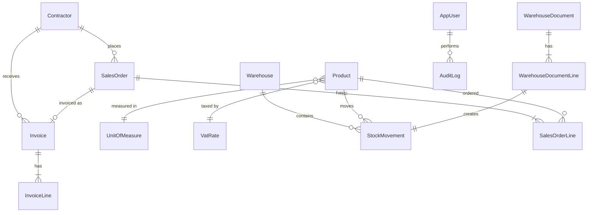

# Model danych (wersja robocza v0.1)

Model jest punktem wyjścia. Ma się zmieniać wraz z tym, jak rozumiesz problem. Każdą większą zmianę
zapisuj w sekcji „Decyzje projektowe” na dole.

## Diagram relacji (uproszczony)

## Encje

### Słowniki
| Encja | Najważniejsze pola | Uwagi |
|---|---|---|
| `UnitOfMeasure` | Id, Code (szt., kg, m), Name | `AllowsFraction` (czy dopuszcza ułamki) |
| `VatRate` | Id, Name, Percentage | np. 23%, 8%, 5%, 0%, zw. |

### Kontrahenci
| Pole | Typ | Uwagi |
|---|---|---|
| Id | Guid | klucz główny |
| Name | string | wymagane |
| TaxId (NIP) | string? | walidacja formatu i sumy kontrolnej |
| Type | enum | Customer, Supplier, Both |
| Address (ulica, miasto, kod, kraj) | pola lub typ złożony | |
| Email, Phone | string? | |
| IsActive | bool | soft delete |
| CreatedAt, UpdatedAt | DateTime | |

### Towary
| Pole | Typ | Uwagi |
|---|---|---|
| Id | Guid | |
| Sku | string | unikalny kod wewnętrzny |
| Name | string | |
| Ean | string? | |
| UnitOfMeasureId | FK | |
| VatRateId | FK | |
| SalePriceNet | decimal(18,2) | |
| IsActive | bool | |

### Magazyn
| Encja | Najważniejsze pola | Uwagi |
|---|---|---|
| `Warehouse` | Id, Code, Name, IsActive | |
| `StockMovement` | Id, WarehouseId, ProductId, Quantity (+/−), MovementType, DocumentLineId, OccurredAt | **append-only, nigdy nie edytujemy** |
| `WarehouseDocument` | Id, Number, Type (PZ/WZ/MM/Correction), Status, WarehouseId, ContractorId?, CreatedAt, ApprovedAt | |
| `WarehouseDocumentLine` | Id, DocumentId, ProductId, Quantity | |

**Stan magazynowy** = suma `Quantity` z ruchów dla pary (magazyn, towar). Na początku liczymy
zapytaniem, później możesz dodać tabelę zbiorczą `StockLevel` jako optymalizację (i uczyć się,
jak utrzymać spójność).

**Rezerwacje:** osobna encja `StockReservation` (ProductId, WarehouseId, Quantity, SalesOrderLineId).
Dostępne = stan − suma rezerwacji.

### Sprzedaż
| Encja | Najważniejsze pola | Uwagi |
|---|---|---|
| `SalesOrder` | Id, Number, ContractorId, Status, OrderDate, CreatedBy | Status: Draft → Confirmed → Fulfilled / Cancelled |
| `SalesOrderLine` | Id, OrderId, ProductId, Quantity, UnitPriceNet, DiscountPercent, VatRateId | **cena i VAT kopiowane w momencie zamówienia** (zmiana ceny towaru nie psuje starych zamówień) |

### Faktury
| Encja | Najważniejsze pola | Uwagi |
|---|---|---|
| `Invoice` | Id, Number, ContractorId, SalesOrderId?, IssueDate, SaleDate, DueDate, TotalNet, TotalVat, TotalGross, Status | Status: Draft → Issued → Cancelled |
| `InvoiceLine` | Id, InvoiceId, ProductName, Quantity, Unit, UnitPriceNet, VatPercentage, NetValue, VatValue, GrossValue | **dane skopiowane, nie referencje**: faktura po wystawieniu jest niezmienna |
| `NumberSequence` | Id, DocumentType, Year, LastNumber | numeracja bez luk, aktualizowana w transakcji |

### Użytkownicy i audyt
| Encja | Najważniejsze pola | Uwagi |
|---|---|---|
| `AppUser` | z ASP.NET Core Identity | role: Administrator, Warehouse, Sales |
| `AuditLog` | Id, UserId, EntityName, EntityId, Action, OldValues (JSON), NewValues (JSON), Timestamp | wypełniane np. w `SaveChanges` |

## Reguły biznesowe (do pokrycia testami)
1. Nie można wydać więcej towaru niż jest dostępne (stan − rezerwacje).
2. Zatwierdzony dokument magazynowy jest niezmienny. Pomyłkę poprawia dokument korygujący.
3. Ilość w ruchu magazynowym nie może być zerem. Jednostki bez ułamków wymagają liczby całkowitej.
4. Zatwierdzenie dokumentu = zmiana statusu + utworzenie ruchów w **jednej transakcji**.
5. Zamówienie potwierdzone tworzy rezerwacje. Anulowanie je zwalnia.
6. Faktura: kwoty brutto/netto/VAT wyliczane z linii, zaokrąglane zgodnie z jedną, jawną regułą.
7. Numer dokumentu jest unikalny i narastający w ramach (typ, rok). Brak luk.
8. Kontrahent z dokumentami nie może być usunięty fizycznie, tylko dezaktywowany.
9. NIP musi mieć poprawny format i sumę kontrolną.

## Kwestie techniczne
- **Pieniądze:** `decimal(18,2)` dla kwot, `decimal(18,4)` dla ilości i cen jednostkowych.
- **Klucze:** `Guid` (generowane w aplikacji) ułatwiają późniejszą synchronizację i testy.
- **Współbieżność:** token współbieżności na kluczowych encjach (stany, dokumenty). W PostgreSQL EF Core
  używa do tego kolumny systemowej `xmin`, a w SQL Server pola `RowVersion`. Omów z Claude Code różnicę. Ćwiczenie:
  dwóch użytkowników wydaje ostatnią sztukę, co się dzieje?
- **Indeksy:** unikalne na `Sku`, `Number`, `TaxId` (z filtrem dla NULL), indeksy na kluczach obcych
  używanych w zapytaniach o stany.
- **Daty:** UTC w bazie.

## Rozszerzenia (stretch)
- `ProductVariant` (kolor, rozmiar) i atrybuty wariantów
- `Batch` / partie z terminem ważności i metodą FIFO/FEFO
- Kursy walut, wiele cenników, rabaty kontrahentów

## Decyzje projektowe (uzupełniaj na bieżąco)
| Data | Decyzja | Powód | Alternatywy |
|---|---|---|---|
| | Stan magazynowy jako suma ruchów | Pełna historia, audytowalność | Pole „ilość” edytowane bezpośrednio |
| | Faktura kopiuje dane towaru | Niezmienność po wystawieniu | Referencje do towaru |
